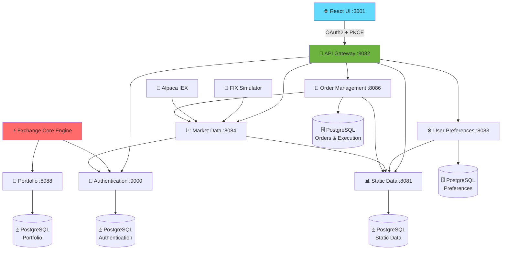

<div align="center">

# 🚀 TradeSphere

### Enterprise-Grade Distributed Stock Trading Platform

[](https://www.oracle.com/java/)
[](https://spring.io/projects/spring-boot)
[](https://react.dev/)
[](https://www.postgresql.org/)
[](https://grpc.io/)
[](https://github.com/keshav/tradesphere)

**Built by Keshav**

---

</div>

## 📖 Overview

**TradeSphere** is a high-performance, enterprise-grade distributed stock trading platform designed with modern microservices architecture. Built using **Java 21**, **Spring Boot 4.0.7**, **React 19**, **gRPC**, and **PostgreSQL**, it delivers ultra-low latency order execution and real-time market data processing.

### 🎯 Key Features

- **🔥 Ultra-Low Latency**: In-process execution routing eliminates network hops
- **⚡ Zero-Hop Pipeline**: Three-leg direct execution flow without message brokers
- **🎨 Modern Tech Stack**: Java 21, Spring Boot 4, React 19, gRPC
- **🏗️ Microservices Architecture**: Domain-driven design with independent service boundaries
- **💾 Database Per Service**: Each microservice owns its PostgreSQL database
- **🔐 OAuth2/OIDC**: Enterprise-grade authentication and authorization
- **📊 Real-Time Market Data**: Support for simulated, Alpaca IEX, and FIX protocol feeds
- **🧪 91.95% Test Coverage**: Comprehensive testing with JaCoCo
- **🐳 Docker Ready**: Full containerized deployment support

---

## 🏛️ System Architecture

TradeSphere follows a **domain-driven microservices architecture** with strict service boundaries. Each service owns its business capability and database independently.

### 🎯 Core Services

| Service | Port | Responsibility |
|---------|------|----------------|
| **Authentication** | 9000 | OAuth2/OIDC login, user management, JWT tokens |
| **Static Data** | 8081 | Financial instruments and exchange listings |
| **User Preferences** | 8083 | User watchlists and workspace layouts |
| **Market Data** | 8084 | Real-time market feeds, order books, price streaming |
| **Order Management** | 8086 | Order lifecycle, state machine, execution routing |
| **Portfolio** | 8088 | Position tracking, P&L calculation, risk management |
| **API Gateway** | 8082 | Routing, security boundary, load balancing |
| **Frontend** | 3001 | React-based trading workspace UI |

---

## 🔄 Architecture Diagram



### 🎯 Architecture Highlights

- **API Gateway**: Single entry point with OAuth2 security
- **Database Isolation**: Each service owns its PostgreSQL database
- **In-Process Execution**: Zero network latency between order intake and routing
- **LMAX Disruptor**: Ultra-low latency order processing pipeline
- **Event-Driven**: Sharded event dispatcher for parallel processing

---

## ⚡ Ultra-Low Latency Order Execution

### 🚀 Zero-Hop In-Process Pipeline

TradeSphere achieves ultra-low latency through a **3-leg direct execution pipeline** that runs entirely in-process:

#### 🔥 Hot Path Flow

1. **Order Intake** → API Gateway forwards order to Order Management Service
2. **LMAX Disruptor** → Single-writer pipeline processes command in-memory
3. **Validation** → Instant listing and risk checks (no database blocking)
4. **State Machine** → In-memory order cache updated
5. **Event Dispatch** → Sharded dispatcher routes to execution engine
6. **Write-Behind** → Async database persistence (after response returned)

**⏱️ Result**: Sub-millisecond order acknowledgment with zero blocking DB calls on the hot path.

### 📊 Order Execution Strategies

| Strategy | Description | Use Case |
|----------|-------------|----------|
| **DMA** | Direct Market Access - sends order to single venue | Fast execution at specific exchange |
| **SMART** | Intelligent routing across multiple venues by price/time | Best execution across all liquidity |
| **VWAP** | Volume-Weighted Average Price slicing | Large orders split over time |

### 🔄 Execution Flow

```
User Order → Gateway → OMS Disruptor → State Machine → Sharded Dispatcher
                                                              ↓
                                                    Execution Engine
                                                              ↓
                                    ┌─────────────┬──────────┴────────┬──────────────┐
                                    ↓             ↓                   ↓              ↓
                                  DMA         SMART                VWAP      FIX Gateway
                                    ↓             ↓                   ↓              ↓
                                Venue 1    Venues 1-N         Time Sliced      External
```

---

## 🛠️ Tech Stack

<div align="center">

| Category | Technologies |
|----------|-------------|
| **Backend** | Java 21, Spring Boot 4.0.7, Spring Cloud Gateway |
| **Frontend** | React 19, JavaScript/TypeScript, Modern UI |
| **Communication** | gRPC, REST API, WebSocket, Server-Sent Events (SSE) |
| **Database** | PostgreSQL 16, Flyway Migrations |
| **Message Processing** | LMAX Disruptor (in-process) |
| **Security** | OAuth2, OIDC, JWT, PKCE |
| **Market Data** | Alpaca IEX, FIX Protocol, Simulated Feeds |
| **Testing** | JUnit 5, Testcontainers, Property-Based Testing |
| **DevOps** | Docker, Docker Compose, Maven |
| **Matching Engine** | Exchange-Core (LMAX Disruptor-based) |

</div>

---

## 📋 Prerequisites

Before running Emporia locally, ensure you have:

- ☕ **Java 21** or newer
- 📦 **Maven 3.9+**
- 🟢 **Node.js** and npm
- 🐘 **PostgreSQL 16** (for local mode) or **Docker** (for containerized mode)
- 🐳 **Docker** with Docker Compose (for containerized deployment)
- ⚡ **Exchange-Core Engine** (clone and install separately)

### 🗄️ Local PostgreSQL Configuration

For non-Docker local runs:

```yaml
Database: tradesphere
Host: localhost:5432
Username: <your-os-username>  # Default OS username, not 'postgres'
Password: admin123
```

---

## 🚀 Quick Start

### 📝 Deployment Modes

TradeSphere supports three deployment modes:

| Mode | Spring Services | PostgreSQL | Database Layout |
|------|----------------|------------|-----------------|
| **1. Local** | Host JVM | Local (`localhost:5432`) | Single database with schemas |
| **2. Infrastructure Docker** | Host JVM | Docker containers (`5433-5438`) | One DB container per service |
| **3. Full Docker** | Docker containers | Docker containers | One DB container per service |

---

### 🎬 Mode 1: Local Development (Recommended for Development)

**Step 1**: Install Exchange-Core dependency

```bash
git clone https://github.com/exchange-core/exchange-core.git
cd exchange-core
mvn clean install
cd ..
```

**Step 2**: Start all services locally

```bash
scripts/run-local.sh
```

**Step 3**: Access the application

```
🌐 Frontend: http://localhost:3001
👤 Username: admin
🔑 Password: admin123
```

The script will:
- ✅ Build all Maven projects
- ✅ Start all microservices in background
- ✅ Wait for health checks
- ✅ Seed portfolio balances
- ✅ Display service URLs

**Logs**: All service logs are saved to `.local-run/logs/<service>.log`

---

### 🐳 Mode 2: Infrastructure Docker (Services on Host, DBs in Docker)

```bash
scripts/run-infra-docker.sh
```

This mode:
- Runs PostgreSQL containers for each service
- Runs Spring Boot services on your host machine
- Useful for debugging services while having isolated databases

---

### 🐳 Mode 3: Full Docker Deployment

**Step 1**: Build Maven artifacts

```bash
mvn clean install -DskipTests
```

**Step 2**: Deploy with Docker Compose

```bash
scripts/local-deploy.sh
```

This mode runs everything in containers - perfect for production-like testing.

---

### 🔌 Using Live Market Data (Alpaca IEX)

To use real market data instead of simulated feeds:

**1. Get Alpaca API Keys** (Free)
   - Sign up at [alpaca.markets](https://alpaca.markets)
   - Navigate to Paper Trading dashboard
   - Generate API credentials

**2. Start with Alpaca Integration**

```bash
MARKET_DATA_PROVIDER=alpaca-iex \
APCA_API_KEY_ID='your-key-id' \
APCA_API_SECRET_KEY='your-secret-key' \
scripts/run-local.sh
```

---

### 🛑 Stop All Services

```bash
scripts/stop-services.sh
```

This stops all running services and Docker containers across all modes.

---

## 🔍 Monitoring & Health Checks

### Check All Services

```bash
# Quick health check for all services
for pair in "authentication:9000" "static-data:8081" "user-preferences:8083" \
            "market-data:8084" "order-management:8086" \
            "portfolio:8088" "gateway:8082"; do
  name="${pair%%:*}"; port="${pair##*:}"
  echo "$name: $(curl -fsS http://localhost:$port/actuator/health)"
done
```

### View Logs

```bash
# View all running service PIDs
cat .local-run/pids/*.pid

# Tail specific service logs
tail -f .local-run/logs/order-management-service.log
tail -f .local-run/logs/market-data-service.log
```

---

## 🧪 Testing & Quality

### Test Coverage: **91.95%** (JaCoCo)

Run comprehensive test suite:

```bash
mvn verify
```

### Testing Stack

- ✅ **JUnit 5**: Unit and integration tests
- ✅ **Testcontainers**: PostgreSQL integration tests
- ✅ **Property-Based Testing**: Fray concurrency verification
- ✅ **PMD**: Static code analysis
- ✅ **JaCoCo**: Code coverage reports

### Pre-Push Validation

Install Git hooks for local CI:

```bash
scripts/install-git-hooks.sh
```

This automatically runs `mvn verify` + frontend checks before every push.

---

## 🐳 Docker Deployment Details

### Infrastructure-Only Docker (Mode 2)

Starts PostgreSQL containers while running services on host:

```bash
# Start infrastructure containers
docker compose up -d

# Check container status
docker compose ps

# Stop infrastructure
docker compose down
```

**PostgreSQL Container Ports:**

| Database | Host Port | Schema | Owner |
|----------|-----------|--------|-------|
| `tradesphere_authentication` | 5433 | `tradesphere_authentication` | authentication |
| `tradesphere_static_data` | 5434 | `tradesphere_static_data` | static-data |
| `tradesphere_user_preferences` | 5435 | `tradesphere_client_config` | user-preferences |
| `tradesphere_order_management` | 5436 | `tradesphere_order_data` | order-management |
| `tradesphere_execution` | 5437 | `tradesphere_execution` | order-management |
| `tradesphere_portfolio` | 5438 | `tradesphere_portfolio` | portfolio |

### Full-Stack Docker (Mode 3)

Deploy all services and databases in containers:

```bash
# Build JARs first
mvn clean install -DskipTests

# Deploy full stack
scripts/local-deploy.sh

# Or with Alpaca market data
MARKET_DATA_PROVIDER=alpaca-iex \
APCA_API_KEY_ID='your-key' \
APCA_API_SECRET_KEY='your-secret' \
scripts/local-deploy.sh

# Stop everything
scripts/stop-services.sh
```

---

## 🎓 Key Design Patterns

TradeSphere implements several enterprise design patterns:

- **🔄 CQRS**: Command Query Responsibility Segregation
- **📡 Event-Driven Architecture**: Asynchronous event processing
- **🎭 Saga Pattern**: Distributed transaction management
- **🎯 Strategy Pattern**: Pluggable execution algorithms (DMA, SMART, VWAP)
- **🤖 State Machine**: Order lifecycle management
- **💍 Circuit Breaker**: Fault tolerance and resilience
- **🚪 API Gateway**: Single entry point with routing

---

## 🚀 Performance Highlights

- ⚡ **Sub-millisecond** order acknowledgment
- 🔥 **Zero network hops** between order intake and execution
- 💾 **No blocking DB calls** on the hot path
- 🎯 **In-memory state machine** for order management
- 📊 **LMAX Disruptor** for ultra-low latency processing
- 🔀 **Sharded event processing** for parallel order handling
- 📝 **Write-behind persistence** for non-blocking durability

---

## 📚 Project Structure

```
tradesphere/
├── authentication/              # OAuth2/OIDC service
├── static-data-service/         # Financial instruments
├── user-preferences-service/    # User settings
├── market-data-service/         # Market feeds & order books
├── order-management-service/    # Order processing & execution
├── portfolio-service/           # Position tracking & P&L
├── gateway/                     # API Gateway
├── frontend/                    # React UI
├── trading-contracts/           # Shared Java contracts
├── fix-simulator-contracts/     # FIX protocol contracts
├── fix-market-simulator/        # FIX market simulator
├── scripts/                     # Deployment scripts
└── docs/                        # Documentation
```

---

## 🤝 Contributing

Contributions are welcome! This project demonstrates enterprise-grade architecture and trading system design.

---

## 📄 License

This project is available for educational and portfolio purposes.

---

<div align="center">

### 🌟 Built with ❤️ by Keshav

**TradeSphere** - Enterprise-Grade Distributed Stock Trading Platform

[](https://www.oracle.com/java/)
[](https://spring.io/projects/spring-boot)
[](https://react.dev/)
[](https://www.postgresql.org/)

---

**⭐ Star this repository if you find it useful!**

</div>
